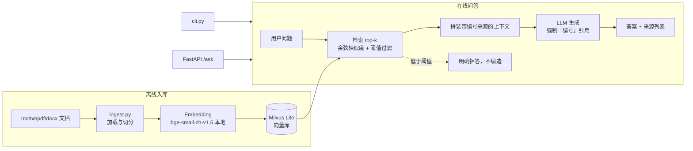

# RAG 私有知识库（Milvus + 本地 Embedding）

基于 **Milvus（milvus-lite）+ bge-small-zh-v1.5** 的企业制度知识库问答系统：文档解析、切分、向量化入库、检索增强生成、答案带来源引用，越界问题明确拒答。内置 5 份工地安全制度文档和 30 题评测集，同时也是后续「工地安全事件智能助手」项目的制度问答底座。

## 架构



关键设计：

- **引用溯源**：每个 chunk 带来源文件名和序号，答案中用 `[编号]` 标注出处，接口同时返回来源列表与相似度。
- **拒答兜底**：检索得分全部低于阈值时直接回复"未提及"，不进入生成环节——宁可拒答，不可编造。
- **Milvus 一套接口三种部署**：本地 milvus-lite 文件库（开发）、自建 Milvus（Docker）、Zilliz Cloud（生产），切换只改 `.env`。
- **Embedding 可替换**：默认本地 bge 模型（免费、离线、中文优化）；支持任意 OpenAI 兼容 Embedding 接口。

## 快速开始

```bash
pip install -r requirements.txt
cp .env.example .env   # 填 LLM key（Embedding 默认本地模型，无需 key）

python cli.py ingest                    # 入库 data/kb/ 下的文档
python cli.py ask "安全帽有效期多久？"    # 单次问答
python cli.py chat                      # 连续对话
python api.py                           # 或启动 FastAPI，POST /ask（端口 8001）
```

## 评测

30 题评测集：28 题库内问答（覆盖 5 份制度文档的关键数字与条款，含 8 道同义换说法题）+ 2 题越界拒答。

```bash
python eval/run_eval.py
```

指标：**检索命中率**（期望来源是否进入 top-k）、**答案命中率**（answer_checks 同义组判分：组间 AND、组内 OR）、**引用规范率**（是否标注来源编号）、**越界拒答正确率**、平均时延与成本。

最新一轮真实模型结果：**检索命中率 100%、答案命中率 100%（28/28）、越界拒答 2/2、引用规范率 100%，平均时延 2.79 秒，30 题总成本 ¥0.0712**。4 轮迭代的完整记录（含一次判分器误判的排查过程）见 [eval/REPORT.md](eval/REPORT.md)。

## 目录结构

```
data/kb/        # 知识库文档（5 份工地安全制度，示例数据）
src/ingest.py   # 文档加载与切分（段落优先 + 超长滑窗硬切）
src/embed.py    # Embedding 后端（本地 bge / OpenAI 兼容接口）
src/store.py    # Milvus 封装（lite 文件库 / 服务 / Zilliz Cloud 同接口）
src/rag.py      # 检索 + 生成 + 引用 + 拒答兜底
cli.py / api.py # 命令行与 HTTP 两种入口
eval/           # 评测集、评测脚本、评测报告
```

## 数据来源与边界

- `data/kb/` 下 5 份制度文档为演示用示例文本，非真实企业制度。
- 本地 Embedding 模型首次运行需下载（约 100MB）；内网环境可设 `HF_ENDPOINT=https://hf-mirror.com` 加速。
- 评测结论基于本知识库与评测集，不代表任意文档集合上的表现。
